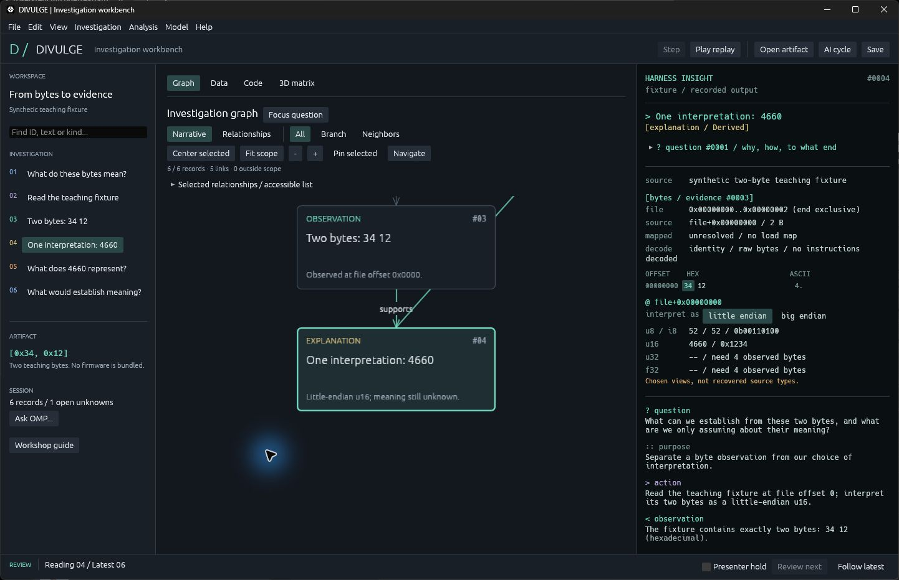
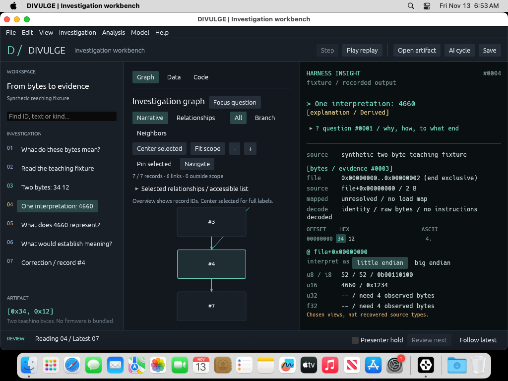

# DIVULGE

**See the question. Follow the evidence. Understand the investigation.**

DIVULGE is a native Rust/egui workbench for AI-assisted reverse engineering. The human sets the objective and steers; the AI carries out bounded investigations. A graph and a detailed **Harness Insight** panel keep the process understandable at a human reading pace.

The first case study is official M-VAVE FM-1 V15 firmware and the pi32v2 architecture. A companion workshop introduces Rust through the actual types behind the application.

## Native desktop packages

The [0.1.0 release](https://github.com/superposition/DIVULGE/releases/tag/v0.1.0) includes the native executable, matching source, 18-page workbook, six Rust checkpoints and synthetic replay. Read [START-HERE](START-HERE.md) after extracting the package. [Release notes](docs/release-notes.md) and the [rehearsal record](docs/rehearsal.md) state the verified behavior and remaining limits.

The native packaging workflow also builds the same egui app as **`DIVULGE.app` for Apple Silicon macOS**, suitable for M1/M2/M3/M4 Macs. It runs the Rust tests on each host, verifies package hashes, and captures the Mac window using the synthetic workshop. See [native targets](docs/native-targets.md) for package contents, build commands and qualification boundaries. The existing tagged 0.1.0 download is the earlier Windows release; newer build artifacts identify their exact source commit.

## How to use

### Open the app

| Your computer | Package to choose | What to open |
| --- | --- | --- |
| Windows, Intel/AMD 64-bit | `DIVULGE-windows-release` / `windows-x86_64` | Extract the whole application ZIP, then run `divulge.exe`. |
| M3 Mac, or another Apple Silicon Mac | `DIVULGE-macos-arm64-release` / `macos-arm64` | Extract the application ZIP, then open `DIVULGE.app`. You can copy the app to Applications. |

For the **3D matrix and current Windows/M3 builds**, open [Native desktop packages in Actions](https://github.com/superposition/DIVULGE/actions/workflows/release-check.yml), choose the latest successful run for `main`, and download your platform from **Artifacts**. GitHub may require sign-in. Extract that artifact download, then extract the application ZIP inside its `release` folder. The [tagged v0.1.0 Windows release](https://github.com/superposition/DIVULGE/releases/tag/v0.1.0) is the earlier version and does not include the new matrix or Mac package.

Reading the built-in example or a saved investigation needs no Rust installation, model credentials, analysis tools or background service. The Mac app is locally signed but not Apple-notarized; if macOS blocks it, review the app and approve it through **System Settings > Privacy & Security > Open Anyway**. More build and platform details are in [native targets](docs/native-targets.md).

### Your first investigation

Use **File > New investigation** (**Ctrl+N** on Windows, **Command+N** on Mac) for a blank case. It clears the previous source, graph, 3D matrix, selection and case history; unsaved changes still prompt before being discarded. **File > Load workshop example** loads the teaching case separately.

1. Launch the app. The opening screen contains a synthetic two-byte example, so you can explore immediately.
2. Select a record in the left **Investigation** tree or a node in **Graph**. Read its question, bytes, interpretation and remaining uncertainty in **Harness Insight** on the right. **Center selected** restores readable labels; **Fit scope** shows the current overview.
3. Click **Play replay** to reveal the recorded sequence. **Presenter hold** keeps your reading position steady; **Review next** advances through new records, and **Follow latest** returns to the newest record. Replay makes no model calls.
4. For the saved workshop with an analyst correction, use **File > Open investigation** and choose [`workshop/fixtures/synthetic-workshop.json`](workshop/fixtures/synthetic-workshop.json). Read the accompanying [workshop](docs/workshop.md) or `workshop/DIVULGE-workshop.pdf` in a packaged release.
5. Use **File > Save investigation** to keep your case. Open, Save and Find use **Ctrl** on Windows and **Command** on Mac. **View > Case history and review** shows recorded checkpoints and lets you append steering or corrections.
6. To bring an investigation to the M3, copy your saved `.divulge.json` file and open it there. For selected material, use **File > Export portable review**. Original firmware and credentials are separate; a reopened case needs **File > Verify source** before another live source-dependent probe.

### Opening screen

Actual Windows capture immediately after launching the native egui app, with its built-in teaching example. Screenshots here show opening screens only.



Apple Silicon macOS, opening the included saved workshop in the compact native window:



### Investigate your own artifact

Use **File > Open artifact** to select a local file. DIVULGE hashes the file and records its identity; exact supported FM-1 V15 firmware also enables the decoded **Data** view. Choose **Graph**, **Data**, **Code** or **3D matrix** to inspect it. Firmware and vendor tools are supplied separately. The app does not execute or flash the firmware.

**3D matrix** shows firmware-byte trends: X is byte value, Y is consecutive file regions, height is frequency, and color is region entropy. Drag to rotate, use the camera sliders, or click a point to inspect its exact file range and counts. The numeric region/byte controls provide the same selection. A saved case initially shows its labelled preview; **File > Verify source** enables the complete source matrix. See [reading source-byte trends](docs/source-matrix.md) for limits and interpretation. Only opening-screen screenshots are included above.

Live operations are optional and need tools installed on that computer:

| Operation | Where to start | Prerequisite |
| --- | --- | --- |
| Ask for a next step | **Model > OMP models and next step > Connect / refresh models** | Bun, OMP SDK **18.14.2**, and configured cloud credentials. Select your configured DeepSeek cloud model, review the supplied snapshot, then choose **Propose next step**. |
| Run a bounded AI investigation | **AI cycle** | The configured model and the tool required for the selected scope. Set the objective, scope and budget; use **Pause**, **Resume** and **Stop** to control execution. |
| Inspect original-file entropy | **Analysis > REA original-file evidence** | Compatible Node and the existing REA **6.8.0** package. |
| Disassemble pi32v2 bytes | **Code > Tool / scope**, then **Disassemble selection** | A compatible installed vendor disassembler and Python; Windows uses the selected WSL distribution. Mac live disassembly requires a compatible tool on its analysis host. |

Missing tools are reported as unavailable. The sections below document exact configuration, limits and retained evidence.

## Implemented workflow

- Native File / Edit / View / Investigation / Analysis / Model / Help menus.
- Selectable narrative and settled relationship layouts, branch/neighbor scopes, pinned positions, keyboard navigation and an accessible relationship list. See [graph navigation](docs/graph-navigation.md).
- Terminal-style Harness Insight: file offsets, selectable hex/ASCII bytes, endian-aware scalar views, artifact identity, evidence links, and the question/explanation transcript. Unmapped CPU addresses remain explicitly unresolved.
- Saved question plans explain why a question matters, how to investigate it, what its answer enables, and what evidence is sufficient. **Focus question** or a double-click opens its branch; **Fit scope** shows the overview and **Center selected** restores readable labels.
- Independent execution frontier and reading checkpoint, with new-record counts, Review next, Follow latest and Presenter hold during live work. [Durable branch memory](docs/harness-memory.md) retains relevant evidence, hypotheses, counter-evidence and analyst decisions for OMP.
- Local artifact hashing, bounded byte previews, and comparison with the configured V15 identity.
- Exact-V15 FWSC decoding: eight package entries, header and directory CRCs, raw member CRC comparisons, SFC/JLFS application decoding, and source mappings back to the original file.
- A compact **Data** view shares selection with **Graph**. Inspect field locations and Rust types, sizes, hashes, raw/decoded bytes, flash offsets, and the application's declared address. **Neighbors** brings a record's immediate relationships together.
- A native **3D matrix** counts original source bytes across consecutive file regions. Rotate/zoom the frequency plot, compare region entropy and inspect exact byte ranges; saved previews remain distinct from freshly verified whole files.
- A **Code** view runs the installed vendor pi32v2 disassembler on selected application bytes. It shows 2/4/6-byte instructions, original source offsets, a conservative basic-block graph, and instruction questions, explanations and next probes.
- Each run retains its tool identity, version, flags, exact input, raw outputs, coverage and outcome. Unknown transfers and hardware loops remain unresolved. Cancellation, timeout and tool failure preserve partial output.
- Ordered case history, retained note revisions, analyst steering/corrections/resolutions, offline checkpoint replay, backup recovery and scoped review exports. See [history and sharing](docs/history.md).
- **Model > OMP models and next step** discovers the installed OMP catalogue and proposes a source-linked next byte span. Review its why/how/outcome in Harness Insight, then stage the span in Code. Requests are cancellable; drafts and incomplete outcomes remain distinct from completed proposals.
- Six runnable Rust workshop checkpoints, a checked type catalogue, an 18-page companion workbook and a deterministic synthetic replay with an analyst correction.
- **AI cycle** runs checked proposals sequentially within a chosen scope and budget, with Pause, Resume, Stop and reuse of completed requests. Each follow-up explanation cites actual evidence and states its limitations. See [bounded execution](docs/execution.md).

Bounded AI cycles support the synthetic byte fixture and freshly verified V15 application disassembly. Manual proposals and probe controls remain available. REA supplies canonical entropy evidence through its separate manual operation. Package decoding and the vendor disassembler run locally. Instruction explanations are deterministic descriptions; OMP interpretations are labeled inferred model output. The app does not execute or flash firmware.

## Run

Requires Rust 1.92 or newer and the native build prerequisites for your OS. Windows has the existing interactive validation. macOS has a native packaging/smoke workflow; the record distinguishes build/window checks from optional live-tool validation. Linux remains unverified.

```sh
cargo run --locked
cargo run --locked -- --compact
cargo run --locked -- --large
cargo run --locked --example workshop_types
cargo test --locked --all-targets
```

Open an artifact through **File > Open artifact**, or provide a path:

```sh
cargo run --locked -- --artifact /path/to/your/firmware.fwsc
```

Artifact reads are limited to 128 MiB. Investigation JSON files are limited to 16 MiB, 4,096 events, 200 records, 1,000 edges and 16 disassembly runs. Each run selects 2–4096 bytes and retains at most 256 KiB per output stream. Local cases and their backups retain byte previews, raw tool output, model snapshots and machine paths, including paths in original REA bundles. Credential stores are never copied. Use **File > Export portable review** to choose the material to share.

New saves use a version 2 event-ledger envelope and schema 8 records. Version 1 ledgers remain readable with their original content commitments. Plain schema 1–7 cases migrate as labeled starting snapshots; missing history remains absent. **View > Case history and review** reconstructs checkpoints and appends explicit decisions without rewriting original findings. Reopening runs no tools or models. **File > Verify source** reattaches freshly verified application bytes without replacing notes or records. Older builds cannot read the new envelope.

## OMP next-step proposals

Requires Bun and a separately installed OMP SDK **18.14.2**, the version whose isolation contract is checked here. The CLI may have another version; both are displayed. The bridge discovers the SDK under `~/.bun/install/global/node_modules/@oh-my-pi/pi-coding-agent`; `DIVULGE_OMP_SDK` overrides this directory and `DIVULGE_BUN` overrides the runtime executable. It does not install or upgrade OMP. Auth and the model catalogue come from OMP's existing configuration.

Choose **Model > OMP models and next step > Connect / refresh models**, then select your configured tool-capable DeepSeek cloud model. **Propose next step** sends a bounded snapshot (objective, durable branch memory, up to twelve evidence summaries and at most two 80-row excerpts) to that model's provider. Expand the snapshot to review it first. Configure credentials for the selected cloud provider on that computer before proposing; the global OMP default stays unchanged.

The session exposes one read-only `read_evidence` tool with no filesystem access. MCP, LSP, IRC, extensions, rules, skills and context discovery are disabled. The active tool list is checked before any generation. Rust checks citations, integer offsets, alignment and bounds before recording a proposal. **Stage span in Code** fills the selection; it does not execute it. A new disassembly still requires freshly verified source bytes.

Requests have a 90-second SDK deadline and a 100-second transport deadline with three seconds for cooperative cancellation. Output is capped at 1 MiB, a line at 256 KiB, and a session at 16 AI requests within the 16 MiB save limit. Saves include the exact supplied snapshot and model event transcript, including provisional text; review them before sharing. The global OMP default is never changed.

A real model acceptance check uses synthetic teaching data (substitute a configured provider/model):

```sh
cargo run --locked --example omp_proposal -- --synthetic provider/model
```

For a local parser acceptance check without opening another window:

```sh
cargo run --locked --example inspect_firmware -- /path/to/FM-1_015.fwsc
```

The V15 case produces 699,936 logical package bytes after removing 20 markers, eight entries, and a 581,564-byte application with verified CRC. The application starts at original file offset `0x4534`, flash offset `0x4120`, and declared address `0x02000120`. A declared address is static metadata. Four members have unexplained raw CRC differences; these remain unresolved instead of being labeled corrupt. The format, area offset, and SFC key are supplied by the [MIT reference implementation](THIRD_PARTY.md).

## Read evidence with REA

**Analysis > REA original-file evidence** detects the locally installed REA 6.8.0 package and exposes its read-only `inspect_byte_entropy` operation. Select a file offset, window length (at most 1 MiB), and power-of-two block size. This measures original file bytes, not decoded `app.bin` bytes or mapped memory. The full-file hash must match the current artifact. A reopened case requires **File > Verify original source** before another live read.

The adapter uses an existing compatible Node runtime and REA package. On Windows it discovers the explicit Node/package paths in an installed `rea.cmd` launcher. Otherwise set `DIVULGE_REA_NODE` and `DIVULGE_REA_PACKAGE`, or enter those paths under **Installed REA / prerequisites**. It never installs, repairs, or executes the target. Other package versions fail with an actionable message; native desktop verification is Windows-only.

REA's original `ev_` identity, provider, authority, locations, raw/normalized results and limitations stay intact. A `null` raw result or relationship coverage remains unavailable; an empty examined result remains empty. Canonical entropy bundles for the current artifact can be imported; other operation profiles and residual-unknown bundles are explicitly unsupported. Schema 6 stores the complete original bundle and its semantic commitments. Offline replay checks identities, scope and manifests in Rust and runs neither REA nor a model. Canonical bundle order is not a timeline: each receipt is appended at its DIVULGE application position.

Requests have a 30-second deadline, two seconds for cooperative cancellation, a 2 MiB response cap and a 16-run limit. Incomplete output is diagnostic text, never completed evidence. Saved original bundles contain local paths; portable sharing is a separate export concern.

```sh
cargo run --locked --example rea_evidence -- /path/to/artifact 0 4096
```

## Disassemble a selection

On Windows, install the vendor pi32v2 tools and Python 3 in WSL. **Code > Tool / scope** selects the distribution (default `Ubuntu-22.04`) and executable. An empty executable field discovers only `~/.jieli/toolchain/pi32v2/bin/objdump` inside that distribution. The tools are supplied separately; there is no automatic download. The helper also supports a native Linux host, which has not had desktop validation.

Open V15, choose **Code**, leave the initial `app.bin+0x0 / 256 bytes`, and click **Disassemble selection**. Select an instruction to inspect its bytes and rationale, follow **Inspect target instruction**, or switch to **Control flow**. The first local V15 selection produced 69 instruction rows, 34 blocks and no uncovered bytes. Its first jump resolves from `0x02000120` to `0x02000124`.

Only the validated tool hash and exact flags enable numeric target interpretation. The [synthetic fixtures and validation notes](docs/pi32v2-validation.md) explain the checked displacement convention, gaps, hardware loops and limits. Static edges are candidates, not observed execution or recovered function names.

The same adapter can run without another window:

```sh
cargo run --locked --example disassemble -- /path/to/FM-1_015.fwsc
cargo run --locked -- --session investigation.divulge.json --artifact /path/to/FM-1_015.fwsc
```

## Workshop

The Rust introduction follows one example: `[0x34, 0x12]` becomes an observation, a chosen interpretation, and an unanswered question. It covers bytes, collections, structs, enums, Option, Result, borrowing, and distinct coordinate types.

Follow [the workshop](docs/workshop.md) for Rust code blocks, their output and explanations to read alongside the app. [The talk](docs/talk.md) continues into FM-1 coordinates, pi32v2 instructions, REA evidence and bounded AI investigations. The [type catalogue](docs/type-catalogue.md) covers all 127 named application types. The [18-page workbook](docs/workbook-build.md) uses the same code and spoken narrative.

[Download the code-oriented workbook](https://github.com/superposition/DIVULGE/releases/download/v0.1.0/DIVULGE-workshop-code.pdf).

```sh
python scripts/check_workshop.py
python scripts/check_catalogue.py
cargo run --locked -- --compact --session workshop/fixtures/synthetic-workshop.json
```

## Project map

| Folder | What it contains | Start here |
| --- | --- | --- |
| [`src/`](src/) | The native egui app and its domain, evidence, graph, history and bounded-execution logic. | [`main.rs`](src/main.rs), [`app.rs`](src/app.rs), [architecture](docs/architecture.md). |
| [`adapters/`](adapters/) | Process bridges for OMP, REA and the vendor pi32v2 tool. | [OMP setup](#omp-next-step-proposals), [REA setup](#read-evidence-with-rea), [disassembly setup](#disassemble-a-selection). |
| [`examples/`](examples/) | Runnable Rust lessons and command-line examples for decoding, disassembly, REA and OMP. | [Workshop guide](docs/workshop.md); run `cargo run --locked --example workshop_01_bytes`. |
| [`workshop/`](workshop/) | Saved synthetic investigations, exercises, fonts and workbook assets. | [`fixtures/synthetic-workshop.json`](workshop/fixtures/synthetic-workshop.json), [`exercises/`](workshop/exercises/). |
| [`docs/`](docs/) | User guides, architecture, type catalogue, validation records and the opening-screen images. | [Workshop](docs/workshop.md), [native targets](docs/native-targets.md), [history and sharing](docs/history.md). |
| [`tests/`](tests/) | Synthetic tool-output and evidence fixtures. Most Rust tests live beside the code in `src/`. | Run `cargo test --locked --all-targets`. |
| [`scripts/`](scripts/) | Workbook generation/checks, source catalogue checks, native packaging and package/window verification. | [`package_release.py`](scripts/package_release.py), [`verify_native.py`](scripts/verify_native.py). |
| [`third-party/`](third-party/) | Checked upstream notice sources and pinned license snapshots. | [`THIRD_PARTY.md`](THIRD_PARTY.md). |
| [`.github/workflows/`](.github/workflows/) | Hosted Rust checks and Windows/Apple Silicon package builds. | [`release-check.yml`](.github/workflows/release-check.yml). |

Generated folders are ignored by Git: `target/` holds Rust build files, `output/pdf/` holds generated workbooks, and `output/release/` holds application ZIPs and hashes. `output/native-validation/` holds package-check reports and the Mac launch capture. Keep personal investigations outside the source tree, or under an ignored local path.

- [Architecture and product decisions](docs/architecture.md)
- [Checked domain types and identity rules](docs/domain.md)
- [Milestones and tickets](docs/roadmap.md)
- [Native UI verification](docs/native-validation.md)
- [Contributing](CONTRIBUTING.md)

The project code is MIT licensed. Third-party firmware, vendor tools, REA, OMP, and dependencies retain their own terms. Firmware and vendor binaries are not distributed in this repository.
