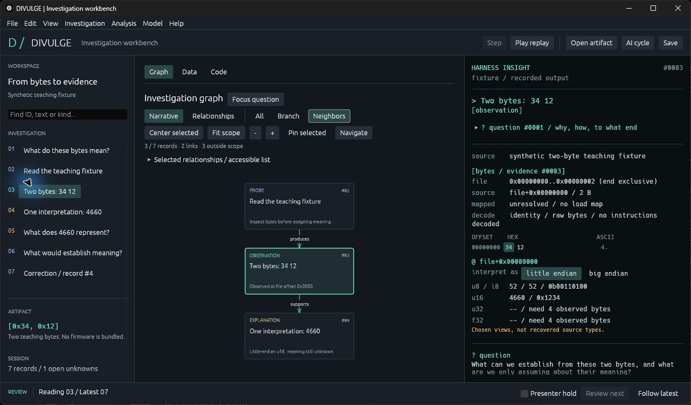

# DIVULGE: from bytes to evidence

## From bytes to evidence

What can we learn from two bytes? We can read them, give them a location, and choose an interpretation. Each of those steps gives us a different kind of information.

```rust
let bytes: [u8; 2] = [0x34, 0x12];
let value = u16::from_le_bytes(bytes);

assert_eq!(value, 4660);
```

We know exactly how this calculation produced 4660. We still need evidence to say what that number represents. It could be a length, a parameter, part of an instruction, or something else.

```text
question
   -> probe
   -> observation
   -> explanation
   -> next question
```

DIVULGE gives each step a record. Rust gives those records a shape. The graph shows how they connect, and the right-hand pane lets us inspect the bytes and the explanation together.

We will begin with the synthetic bytes 34 12, then follow the same ideas into the FM-1 V15 firmware and its pi32v2 instructions.

[examples/workshop_01_bytes.rs](../examples/workshop_01_bytes.rs)

[src/domain.rs](../src/domain.rs)

## Give the question a shape

What makes a question useful? We need to know why it matters, how we can investigate it, and what an answer would let us do.

```rust
pub struct QuestionPlan {
    pub why: String,
    pub steps: Vec<String>,
    pub enables: String,
    pub answered_when: String,
    pub if_not: String,
}
```

A struct brings related values together. Here, each field gives the question a job. The steps are a Vec<String> because a question can need several actions.

```rust
QuestionPlan {
    why: "Choose how to read this field".into(),
    steps: vec!["Compare both byte orders".into()],
    enables: "Choose the next observation".into(),
    answered_when: "A format defines the field".into(),
    if_not: "Keep both interpretations open".into(),
}
```

The question stays attached to the investigation. When we return to a result, we can see what we were trying to establish and which part remains unanswered.

[src/domain.rs](../src/domain.rs)

[docs/domain.md](../docs/domain.md)

## Keep the explanation inspectable

How do we make an investigation understandable while it is happening? We keep the question, the action, the observation and the explanation in named fields.

```rust
pub struct HarnessInsight {
    pub question: String,
    pub purpose: String,
    pub action: String,
    pub observation: String,
    pub explanation: String,
    pub uncertainty: String,
    pub next_step: String,
}
```

String gives each field owned text. The names matter as much as the container: observation describes what we saw; explanation describes what we make of it.

```text
observation: "The bytes are 34 12"
explanation: "Little-endian u16 gives 4660"
uncertainty: "The field meaning is unknown"
next_step:   "Find a format declaration"
```

These are the sections we see in Harness Insight. A useful explanation carries its uncertainty and a next step with it, so we can question the claim without losing the evidence.

[src/domain.rs](../src/domain.rs)

[src/insight.rs](../src/insight.rs)

## The same bytes, two integer views

Do the bytes change when we choose a different byte order?

```rust
fn main() {
    let bytes: [u8; 2] = [0x34, 0x12];
    let view: &[u8] = &bytes;
    let little: u16 = u16::from_le_bytes(bytes);
    let big: u16 = u16::from_be_bytes(bytes);
    println!("Synthetic bytes: {view:02x?}");
    println!("little-endian u16: {little}");
    println!("big-endian u16: {big}");
    println!("Intended meaning: unknown");
}
```

```text
Synthetic bytes: [34, 12]
little-endian u16: 4660
big-endian u16: 13330
Intended meaning: unknown
```

u8 describes one byte. [u8; 2] says the array has exactly two elements. &[u8] borrows a view of those elements. When we call from_le_bytes or from_be_bytes, we choose a rule for combining the bytes into a u16. The bytes themselves stay the same.

In Harness Insight, changing the endian selector changes 4660 to 13330. The observed bytes remain 34 12.

[examples/workshop_01_bytes.rs](../examples/workshop_01_bytes.rs)

## Give the observation an owner

What must we retain so another person can check this observation?

```rust
use divulge::domain::{FileOffset, Observation};

fn main() {
    let observation = Observation {
        offset: FileOffset(0),
        bytes: vec![0x34, 0x12],
        description: String::from("Synthetic teaching bytes"),
    };
    println!(
        "file+0x{:x}: {:02x?}",
        observation.offset.0, observation.bytes
    );
    println!(
        "{} / {} bytes",
        observation.description,
        observation.bytes.len()
    );
    println!("Vec<u8> owns the bytes; String owns the description.");
}
```

```text
file+0x0: [34, 12]
Synthetic teaching bytes / 2 bytes
Vec<u8> owns the bytes; String owns the description.
```

Observation keeps the file location, the bytes and a description together. Vec<u8> owns the byte sequence; String owns the description. We can change the wording while preserving the exact bytes we observed. Rust is describing our evidence record here, not reconstructing a struct from the firmware.

Observation 3 shows file+0 and the same two hex cells. Its mapped address remains unresolved because this fixture has no load map.

[examples/workshop_02_observation.rs](../examples/workshop_02_observation.rs)

## Name the kind of claim

Should a question, an observation and an explanation carry the same fields?

```rust
use divulge::domain::{Investigation, RecordData};

fn main() {
    let case = Investigation::workshop();
    for record in &case.records {
        let kind = match &record.data {
            RecordData::Question => "question",
            RecordData::Probe { .. } => "probe",
            RecordData::Observation(_) => "observation",
            RecordData::Explanation { .. } => "explanation",
            RecordData::Unknown { .. } => "unknown",
            _ => "another implemented record kind",
        };
        println!("#{} {kind}", record.id.0);
    }
}
```

```text
#1 question
#2 probe
#3 observation
#4 explanation
#5 unknown
#6 question
```

RecordData is an enum: a record has one of several shapes. match lets us handle those shapes explicitly. A question asks for evidence, a probe requests an action, and an explanation cites what supports it. The wildcard covers the other variants implemented by DIVULGE.

The graph uses these kinds as card labels. Unknown 5 keeps a question open; question 6 asks what evidence could establish the field's meaning.

[examples/workshop_03_records.rs](../examples/workshop_03_records.rs)

## Absence and failure are different

Is an unknown destination the same as a failed two-byte read?

```rust
use divulge::domain::{FileOffset, MappedAddress, read_u16_le};

fn main() {
    let bytes = [0x34, 0x12];
    let complete: Result<u16, &str> = read_u16_le(&bytes, FileOffset(0));
    let short: Result<u16, &str> = read_u16_le(&bytes[..1], FileOffset(0));
    let destination: Option<MappedAddress> = None;
    println!("Two bytes: {complete:?}");
    println!("One byte: {short:?}");
    match destination {
        Some(address) => println!("Destination: 0x{:x}", address.0),
        None => println!("Destination: unknown; no address was invented"),
    }
}
```

```text
Two bytes: Ok(4660)
One byte: Err("Two bytes are required")
Destination: unknown; no address was invented
```

Result tells us whether an operation succeeded. Option tells us whether a value is present. A failed two-byte read has an error to explain. An unknown address has no value yet. Zero would be a specific address, so we cannot use it to mean that we do not know.

Selecting the last byte, 12, gives u8=18. The u16 view becomes unavailable because only one byte remains in the observed range.

[examples/workshop_04_absence.rs](../examples/workshop_04_absence.rs)

## Borrow data; distinguish coordinates

Can a declared CPU address be passed directly to a file reader?

```rust
use divulge::domain::{FileOffset, MappedAddress, read_u16_le};

fn count(bytes: &[u8]) -> usize {
    bytes.len()
}

fn main() {
    let bytes = vec![0x34, 0x12];
    println!("Borrowed {} bytes", count(&bytes));
    println!("Owner still has: {bytes:02x?}");
    let file_offset = FileOffset(0);
    let declared_address = MappedAddress(0x0200_0120);
    println!("File read: {:?}", read_u16_le(&bytes, file_offset));
    println!("Declared address: 0x{:08x}", declared_address.0);
    println!("These coordinates need a checked map, not a cast.");
}
```

```text
Borrowed 2 bytes
Owner still has: [34, 12]
File read: Ok(4660)
Declared address: 0x02000120
These coordinates need a checked map, not a cast.
```

The function count borrows &[u8], so the Vec remains available afterwards. FileOffset and MappedAddress both contain u64 values, but Rust treats them as different types. A file position and a CPU address need an explicit mapping before we can relate them.

The inspector keeps file offsets, decoded-image offsets and declared addresses visible as separate coordinates. Their numeric values can differ even when they refer to the same instruction.

[examples/workshop_05_coordinates.rs](../examples/workshop_05_coordinates.rs)

## Connect an explanation to evidence

What lets someone challenge an explanation after the model has stopped?

```rust
use divulge::domain::{Investigation, RecordData, RecordId};

fn main() -> Result<(), String> {
    let case = Investigation::workshop();
    case.validate()?;
    let record = case.record(RecordId(4)).ok_or("Missing record 4")?;
    if let RecordData::Explanation { basis, evidence } = &record.data {
        println!("#{} / {basis}", record.id.0);
        for id in evidence {
            let observation = id.resolve(&case)?;
            println!("Evidence #{}: {}", observation.id.0, observation.title);
        }
    }
    println!("Explanation: {}", record.insight.explanation);
    println!("Limitation: {}", record.insight.uncertainty);
    println!("Next: {}", record.insight.next_step);
    Ok(())
}
```

Output excerpt:

```text
#4 / Derived
Evidence #3: Two bytes: 34 12
```

RecordId identifies a record. The explanation holds ObservationId values, which we resolve against the investigation to check that they point to completed evidence. The ? operator returns an error if that lookup fails. Once the link resolves, we can inspect the original observation and challenge the explanation.

In the graph, explanation 4 links to observation 3. Following that link brings us back to the bytes. The integer view is reproducible; the intended meaning is still open.

[examples/workshop_06_evidence.rs](../examples/workshop_06_evidence.rs)

## Let the compiler catch the mix-up

What happens if we give a CPU address to a function that reads a file offset?

```rust
use divulge::domain::{MappedAddress, read_u16_le};

fn main() {
    let bytes = [0x34, 0x12];
    let address = MappedAddress(0x0200_0120);
    println!("{:?}", read_u16_le(&bytes, address));
}
```

```text
error[E0308]: mismatched types
expected `FileOffset`, found `MappedAddress`
```

The function's signature tells us which coordinate it accepts. For this buffer, we know the first byte is at file offset zero.

```rust
use divulge::domain::{FileOffset, read_u16_le};

fn main() {
    let bytes = [0x34, 0x12];
    println!("{:?}", read_u16_le(&bytes, FileOffset(0)));
}
```

```text
Ok(4660)
```

Wrapping the CPU address in FileOffset would make the compiler accept its type, but it would not establish a correct file location. The mapping is a separate fact that we have to obtain.

[workshop/exercises/wrong_coordinate.rs](../workshop/exercises/wrong_coordinate.rs)

[workshop/exercises/coordinate_answer.rs](../workshop/exercises/coordinate_answer.rs)

## Make the byte reader say what failed

The type check protects the coordinate space. We also need to check whether the requested bytes exist. This is the reader used by the examples.

```rust
pub fn read_u16_le(bytes: &[u8], offset: FileOffset) -> Result<u16, &'static str> {
    let start = usize::try_from(offset.0).map_err(|_| "Offset does not fit this platform")?;
    let end = start.checked_add(2).ok_or("Byte range overflows")?;
    let pair = bytes.get(start..end).ok_or("Two bytes are required")?;
    Ok(u16::from_le_bytes([pair[0], pair[1]]))
}
```

First we convert the offset to an index for this platform. checked_add catches arithmetic overflow. get checks whether the complete range is present. Each ? passes a failure back to the caller.

```rust
read_u16_le(&[0x34, 0x12], FileOffset(0))
// Ok(4660)

read_u16_le(&[0x34], FileOffset(0))
// Err("Two bytes are required")
```

Only after those checks do we construct the u16. The function can explain why a read failed, and the rest of the program can keep that failure separate from a successful observation.

[src/domain.rs](../src/domain.rs)

[docs/rust-forms.md](../docs/rust-forms.md)

## Connect records without merging them

An observation and an explanation need separate identities. An edge tells us how they are related.

```rust
pub struct Edge {
    pub from: RecordId,
    pub to: RecordId,
    pub relation: Relation,
}
```

```rust
Edge {
    from: RecordId(3),
    to: RecordId(4),
    relation: Relation::Supports,
}
```



The graph draws this relationship as an arrow. Moving a card changes its position on screen; the IDs and the Supports relationship stay the same. We can also add Revises or Contradicts edges without erasing the original claim.

[src/domain.rs](../src/domain.rs)

[src/graph.rs](../src/graph.rs)

## Bring the pieces together

We can now follow one value all the way through the program: from its bytes, through a chosen interpretation, to the evidence link that lets someone question it.

```text
[0x34, 0x12]
   -> Observation { offset, bytes, description }
   -> RecordData::Explanation { basis, evidence }
   -> HarnessInsight { explanation, uncertainty, .. }
   -> Edge { from, to, relation }
```

In the workshop investigation, explanation 4 says that a little-endian u16 view gives 4660. Its evidence link leads to observation 3. Choosing big endian gives 13330 from those same bytes. The field's intended meaning remains the question to investigate.

```shell
cargo run --locked --example workshop_01_bytes
cargo run --locked --example workshop_02_observation
cargo run --locked --example workshop_03_records
cargo run --locked --example workshop_04_absence
cargo run --locked --example workshop_05_coordinates
cargo run --locked --example workshop_06_evidence
```

File > Open investigation loads workshop/fixtures/synthetic-workshop.json. We can select a claim, follow its evidence, compare interpretations, and record what observation would change our mind.

That is the question to carry into the firmware: what do we know from the bytes, what are we inferring, and what should we inspect next?

[workshop/fixtures/synthetic-workshop.json](../workshop/fixtures/synthetic-workshop.json)

[docs/type-catalogue.md](../docs/type-catalogue.md)

[docs/rust-forms.md](../docs/rust-forms.md)
